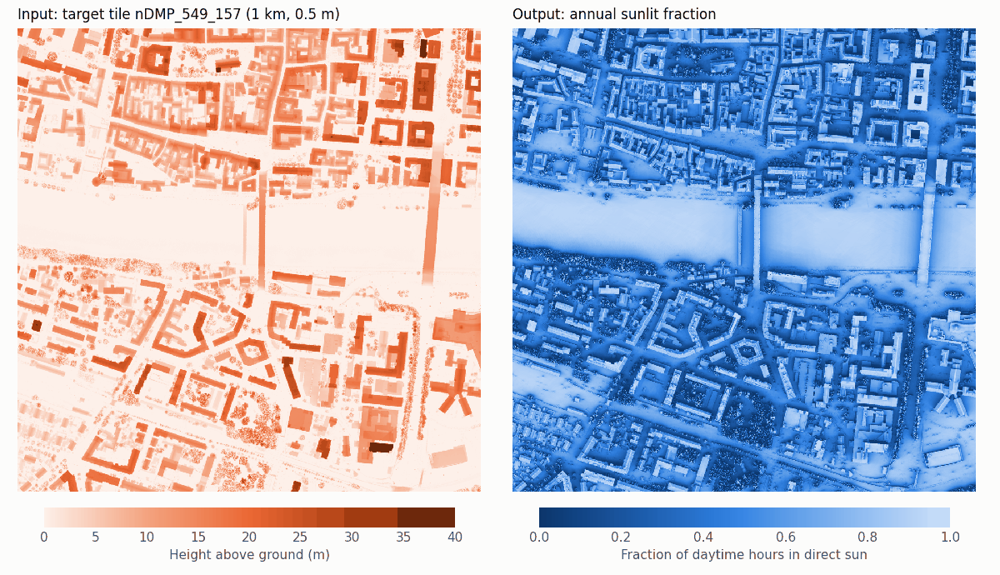

# FastShadowGPU

GPU-accelerated annual shadowing over high-resolution digital surface models (DSMs).
For one target tile, FastShadowGPU computes the fraction of daytime hours in a year
in which each pixel gets direct sun, with the neighbouring tiles as shadow casters.



## How it works

1. All GeoTIFF tiles in a folder are mosaicked into one height grid.
2. Hourly sun positions for one year are computed for the given longitude and latitude
   with the PSA algorithm (Blanco-Muriel et al., *Solar Energy* 70(5), 2001).
3. Daytime hours (sun at least 1° above the horizon) are binned into 5° × 5° sky sectors.
4. For every sector the sun visits, each pixel of the target tile traces one ray towards
   the sector centre through the whole mosaic. If the surface blocks the ray, the pixel
   is shaded for all hours of that sector.
5. The output is `1 - shaded hours / daytime hours`.

Each sector is one CUDA kernel launch with one thread per target pixel, which marches
over the height grid cell by cell (2D DDA). In the example, 4,337 daytime hours
collapse into 264 sectors.

## Build

You need an NVIDIA GPU with the CUDA Toolkit, CMake 3.24 or newer, a C++17 compiler
and libtiff.

Windows (Visual Studio 2022, libtiff from [vcpkg](https://vcpkg.io) via `vcpkg.json`):

```bash
cmake -B build -DCMAKE_TOOLCHAIN_FILE=<vcpkg root>/scripts/buildsystems/vcpkg.cmake
cmake --build build --config Release
```

Linux:

```bash
sudo apt install libtiff-dev
cmake -B build -DCMAKE_BUILD_TYPE=Release
cmake --build build
```

The code is built for the GPU in the build machine. For another GPU, add for example
`-DCMAKE_CUDA_ARCHITECTURES=86`. Tested on Windows 11 with CUDA 12.6 and Visual Studio 2022.

## Usage

```
FastShadowGPU <tiles_dir> <target_tile> <lon> <lat> [output.tif]
```

| Argument | Meaning |
|---|---|
| `tiles_dir` | Folder with the target tile and its neighbours: single-band float32 GeoTIFFs, north up, same square pixel size, heights in metres |
| `target_tile` | File name of the tile to compute |
| `lon`, `lat` | Longitude and latitude of the site in degrees, for the sun path |
| `output.tif` | Output file, by default `<target>_sunlit.tif` in the current folder |

The output is a float32 GeoTIFF on the grid and in the CRS of the target tile.
A value of 1 means direct sun in every daytime hour and 0 means shade all year.

## Example

`example/tiles` holds nine 1 km × 1 km tiles (2000 × 2000 pixels of 0.5 m) of the centre
of Maribor, Slovenia, in EPSG:3794. They are normalised DSMs (heights above ground)
derived from Slovenian national airborne LiDAR data, with heights rounded to 1 cm to keep
the repository small. The target is the middle tile.

```bash
build/Release/FastShadowGPU example/tiles nDMP_549_157.tif 15.6459 46.5547
```

(On Linux the executable is `build/FastShadowGPU`.)

```
9 tiles, mosaic 6000 x 6000 px, pixel 0.5 m; target nDMP_549_157.tif (2000 x 2000) at (2000, 2000)
GPU: NVIDIA GeForce RTX 4090
Traced 264 sky sectors (4337 daytime hours)
Shadowing: 0.47 s
Wrote nDMP_549_157_sunlit.tif
```

## Limitations

- Shadows cast from outside the mosaic are missing. Give the target enough neighbours
  for the lowest sun that matters: at 5° elevation, a 30 m building casts a 340 m shadow.
- Every GeoTIFF in the folder is loaded, so keep only the target and its neighbours there.
- All hours in a sky sector share the shadow test of the sector centre.
- A ray starts two pixels away from its pixel, to avoid self-shadowing on the pixel's own surface.
- Sun positions are for 2026 in UTC. Over a whole year the time zone does not change the result.

## Citation

If you use FastShadowGPU, please cite:

1. N. Lukač, B. Žalik. GPU-Based Solar Irradiance Estimation over Digital Surface Models
   Using Structurally Lossless Viewshed Compression. *Remote Sensing* 18(17), 3044, 2026.
   [doi:10.3390/rs18173044](https://doi.org/10.3390/rs18173044)
2. N. Lukač, D. Mongus, B. Žalik, G. Štumberger, M. Bizjak. Novel GPU-accelerated
   high-resolution solar potential estimation in urban areas by using a modified diffuse
   irradiance model. *Applied Energy* 353, 122129, 2024.
   [doi:10.1016/j.apenergy.2023.122129](https://doi.org/10.1016/j.apenergy.2023.122129)
3. N. Lukač, D. Žlaus, S. Seme, B. Žalik, G. Štumberger. Rating of roofs' surfaces regarding
   their solar potential and suitability for PV systems, based on LiDAR data.
   *Applied Energy* 102, 2013.
   [doi:10.1016/j.apenergy.2012.08.042](https://doi.org/10.1016/j.apenergy.2012.08.042)

## Acknowledgement

Developed at the Faculty of Electrical Engineering and Computer Science, University of
Maribor, with financial support from the Slovenian Research and Innovation Agency
(research project J7-50095, SAMPA, and research core funding P2-0041).

## License

[PolyForm Noncommercial 1.0.0](LICENSE), © 2026 Niko Lukač, University of Maribor.
